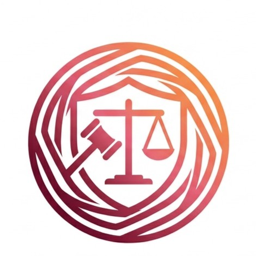
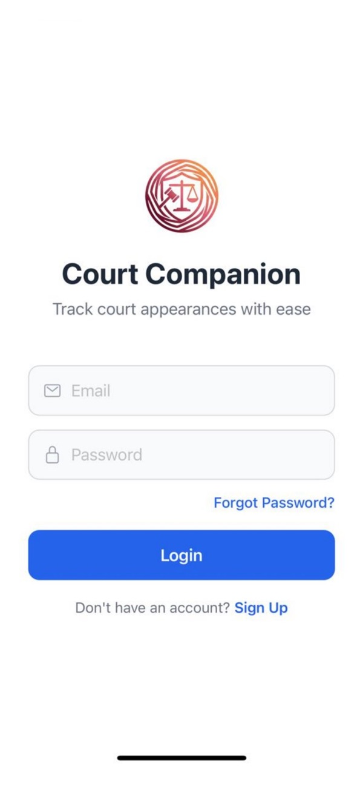
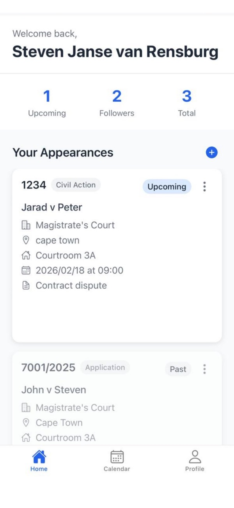
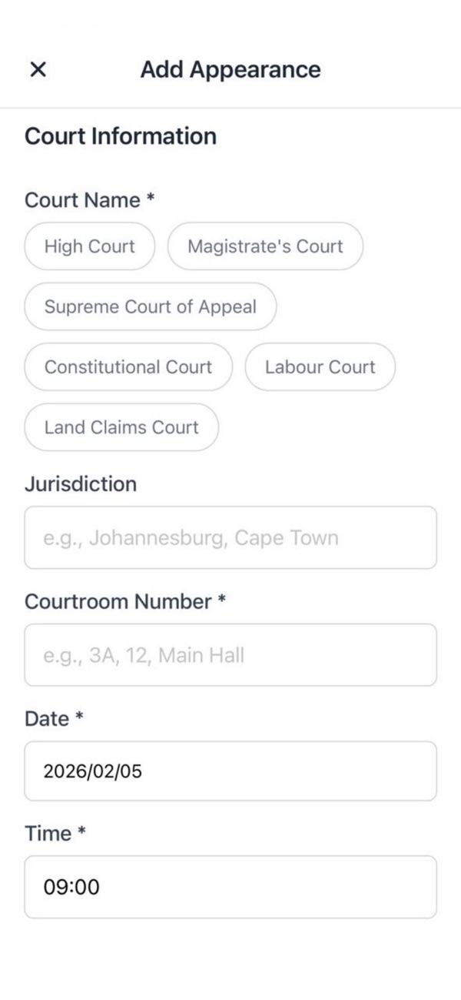
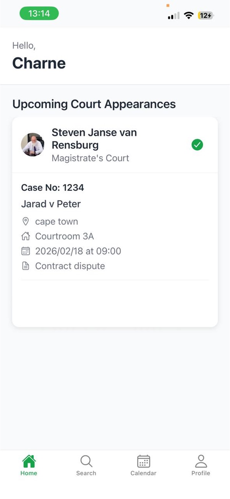
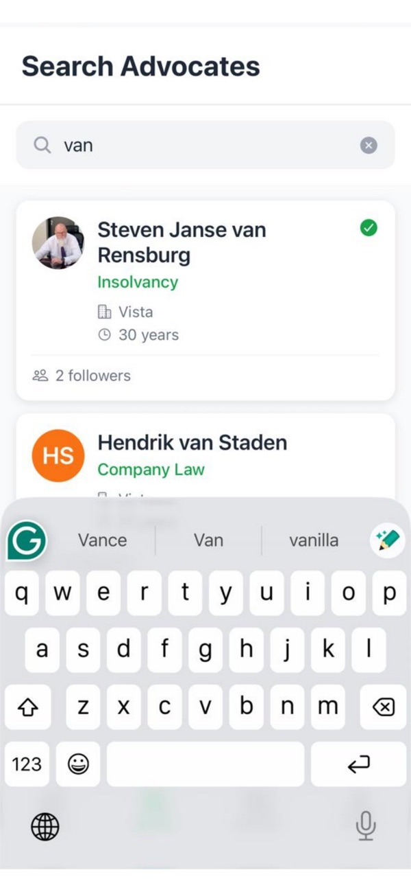
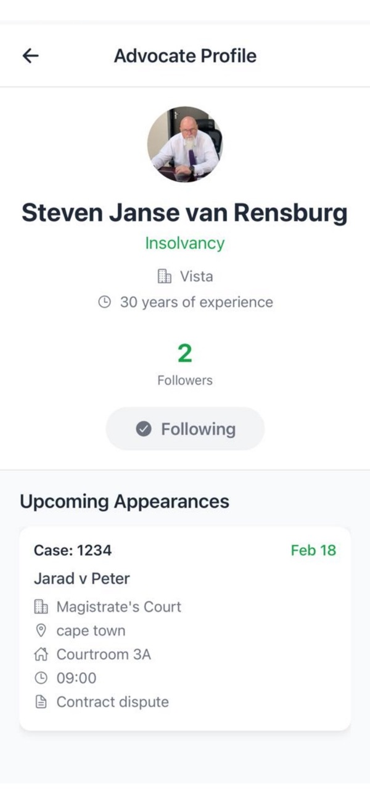
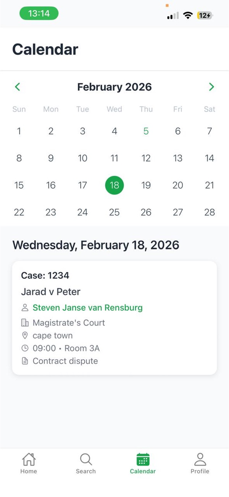
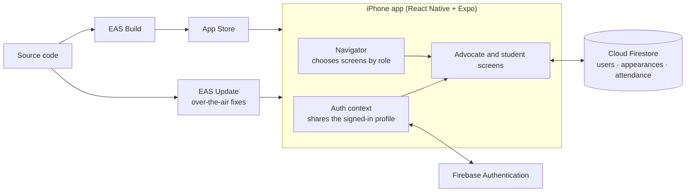

  

<h1 align="center">Court Companion</h1>

  A mobile app that connects South African advocates with the law students who want to watch them in court.

  

---

I was the only developer on Court Companion, which I designed and built as a freelancer for the **National Bar Council of South Africa**. I started it in December 2025, released it on the App Store in March 2026, and kept shipping updates after that. This repo is a showcase: the screenshots, what the app does and how it's built.

> **About the source code:** this is client work for the National Bar Council of South Africa and it's live on the App Store, so the code is in a private repository. I'm happy to walk through it on a call or in an interview.

## The problem

Law students learn a lot by sitting in on real hearings, but finding out where an advocate will be appearing, and when, usually depends on who you know. Advocates have no simple way to share their court schedule with students either. Court Companion gives advocates a place to post their appearances and gives students a way to follow them.

## Screenshots

<table>
  <tr>
    <td align="center"> Sign in</td>
    <td align="center"> Advocate dashboard</td>
    <td align="center"> Adding a court appearance</td>
    <td align="center"> Student home</td>
  </tr>
  <tr>
    <td align="center"> Searching for advocates</td>
    <td align="center"> Following an advocate</td>
    <td align="center"> Calendar</td>
    <td></td>
  </tr>
</table>

## What it does

The app has two kinds of account, and each one gets its own tabs and screens after sign-in.

**Advocates**
- Add, edit and delete court appearances: case number, matter type (civil action, application or criminal matter), court, city, courtroom, date, time, parties and notes
- A dashboard showing upcoming appearances, total appearances and followers, with past cases greyed out
- A monthly calendar of their cases
- Accept or decline follow requests from students, with a badge showing how many are waiting
- Profile with photo, chambers, specialty and years of experience

**Law students**
- Search advocates by name, specialty or chambers, and send a follow request
- See upcoming appearances on the home screen and on a calendar
- View an advocate's profile: chambers, specialty, experience and followers

**Both**
- Email and password accounts with password reset
- Settings, help, terms of service and privacy policy inside the app
- Account deletion from inside the app, which Apple requires

**In progress:** attendance tracking. Advocates can mark which students attended a hearing, and students can keep an attendance record and export it as a CSV file for their law school.

## How it's built

| Area | Technology |
| --- | --- |
| App | React Native 0.81 and React 19, using Expo SDK 54 |
| Navigation | React Navigation: a stack navigator for each role, with bottom tabs |
| Sign-in | Firebase Authentication, with the session kept in AsyncStorage so users stay signed in |
| Data | Cloud Firestore |
| Calendar | A custom month grid, built with React Native components |
| Builds and release | EAS Build for App Store builds, and EAS Update for over-the-air fixes |

A few decisions worth mentioning:

- **The role decides the whole navigator.** After sign-in, the app reads the user's role once and mounts either the advocate stack or the student stack. Screens a role shouldn't reach simply aren't registered for that role.
- **The profile is loaded once and shared.** A React context loads the signed-in user's Firestore profile and hands it to every screen, so screens don't each fetch it again.
- **Follows are single writes.** Follow requests, followers and case attendees are stored as arrays on the relevant documents and updated with Firestore's `arrayUnion` and `arrayRemove`. Accepting a follower doesn't need a separate collection kept in sync.
- **Built for South African courts.** The appearance form has a built-in list of South African courts and cities with autocomplete, so advocates don't have to type full division names.

## What I did

I was the only developer, from the Bar Council's brief to the App Store:

- Took the brief, planned the features and designed the screens, starting in December 2025
- Built the app in React Native and set up Firebase sign-in and the database
- Handled the App Store side: the developer account, signing, the store listing and screenshots, the privacy details, and getting through Apple's review
- Released the first version in March 2026 and shipped updates through version 1.2.8 in May 2026, using EAS for builds and over-the-air updates

## What I'd do next

- Push notifications when a follow request is accepted or a followed advocate adds a case
- Finish attendance tracking, and add PDF export alongside CSV
- An Android release on Google Play, since the same codebase already runs on Android
- Automated tests for the follow and attendance flows

## About

Built by **Charné Janse van Rensburg** (ST10089153) for the National Bar Council of South Africa.

Portfolio: [st10089153.github.io](https://st10089153.github.io)
